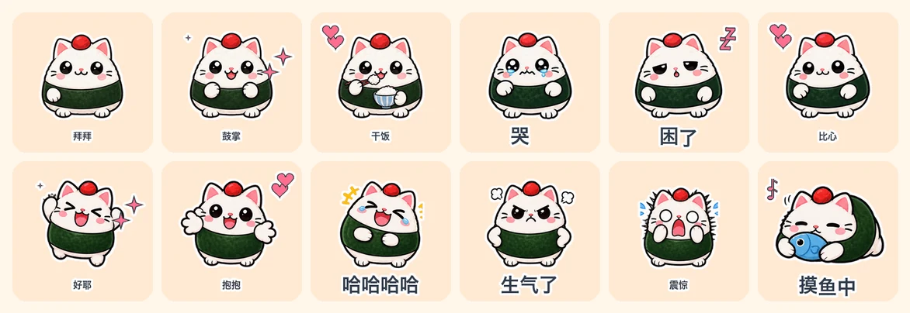

<p align="center">
  
</p>

<p align="center">
  <b>キャラクターの画像 1 枚 → 動くチャットスタンプのフルセット。<br>WeChat、Telegram、LINE、Discord、Slack、WhatsApp の正確なアップロード仕様で書き出します。</b>
</p>

<p align="center">
  <a href="https://github.com/fantuan-lab/animated-sticker-studio/stargazers"></a>
  <a href="https://github.com/fantuan-lab/animated-sticker-studio/releases"></a>
  
  
  
  <a href="LICENSE"></a>
</p>

<p align="center">
  <a href="README.md">English</a> | <a href="README.zh-CN.md">中文</a> | <a href="README.ja.md"><b>日本語</b></a>
</p>

# Animated Sticker Studio

AI のコーディングエージェントにキャラクターの画像を 1 枚（または説明だけ）渡すと、**本当に動く**チャットスタンプのフルセットが返ってきます。キャプションとポーズを考え、すべてのキーフレームを描き、文字とエフェクトを加え、各プラットフォームの正確なアップロード仕様で書き出し、すべてのファイルをサイズの上限以下に圧縮し、自分の作業をチェックして、zip にまとめます。

Claude Code、Codex、そのほか Python を実行できるエージェントならどれでも動きます。

## 例：おにぎり猫 · 24 個のスタンプ

1 回の実行で作ったオリジナルのキャラクターです。キャラクターシート 1 枚 + ポーズシート 3 枚 = 画像生成の呼び出し 4 回で、手作業の修正はしていません。下に示しているのは WeChat Sticker Platform 向けの書き出し（240×240、各 500 KB 以下）で、2026-11-05 に WeChat の審査に提出しました。

**#1–16**：それぞれ 1 つのポーズに、プロシージャルな動きを加えたもの。**#17–24**：本物のコマ送りのアニメーションです。前足を振る、涙が流れる、あくびで口が開く、といった動きをします。

| | | | | | |
|---|---|---|---|---|---|
| <br>001-收到 | <br>002-好耶 | <br>003-抱抱 | <br>004-早安 | <br>005-在吗 | <br>006-哈哈哈哈 |
| <br>007-委屈 | <br>008-生气了 | <br>009-我想想 | <br>010-加油 | <br>011-谢谢老板 | <br>012-溜了 |
| <br>013-震惊 | <br>014-摸鱼中 | <br>015-好的 | <br>016-冲鸭 | <br>017-拜拜 | <br>018-鼓掌 |
| <br>019-打字中 | <br>020-干饭 | <br>021-点赞 | <br>022-哭哭 | <br>023-困了 | <br>024-比心 |

<details>
<summary>同じパックを 4 つのプラットフォームに書き出し、すべて仕様のチェックに合格しています</summary>

| プラットフォーム | 仕様 | 最大 / 平均のファイルサイズ | 上限 |
|---|---|---|---|
| 汎用 GIF | 320×320 GIF | 702 KB / 578 KB | 1 MB（目安） |
| WeChat Sticker Platform | 240×240 GIF + 120 のサムネイル + 透過のカバーとアイコン | 442 KB / 368 KB | 500 KB |
| Telegram のビデオスタンプ | 512×512 の透過 WebM VP9 | 128 KB / 94 KB | 256 KB |
| LINE のアニメーションスタンプ | 320×270 APNG、12 フレーム、2 ループ | 298 KB / 270 KB | 300 KB |

</details>

## できること

- **キャラクターが本当に動きます。** ジェスチャーのスタンプには、手描きのキーフレームが 2～4 枚（手を振る、拍手、タイピング、食べる、泣く、あくび…）あり、そこにプロシージャルな動きが重なります。ほとんどの AI スタンプのツールは、1 枚の静止画をスライドさせたりつぶしたりするだけです。
- **22 種類のシームレスな動きのプリセット**、5 種類のキャプションのアニメーション（ポップ、タイプライター、ウェーブ、シェイク、静止）、どのサイズでもくっきりした 17 種類のベクターのエフェクトアイコン。
- **滑らかなイラスト、またはピクセルアート** での描画。
- **プラットフォームのプリセット**：汎用 GIF、WeChat Sticker Platform、Telegram、LINE、Discord、Slack、WhatsApp。サイズ、形式、フレーム数、長さ、バイト数の上限に対応します。ファイルは収まるまで再エンコードされ、使った設定が記録されます。
- 各プラットフォームが求める **付属の画像**：WeChat のサムネイル / カバー / チャットのアイコン、LINE のメインとタブ、Telegram と WhatsApp のパックのアイコン。
- **堅実な切り抜き**：単色の背景や、画像モデルがよく描いてしまう偽の「透過」の市松模様を取り除きます。スプライトをそのピクセルから見つけるので、不揃いなグリッドでもきれいに切り抜けます。アトラスごとに番号付きの索引シートを書き出します。
- **エージェントが実際に見られるセルフレビュー**：エージェントは GIF を見られないので、すべてのスタンプを、明暗を交互にした行に 4 フレームずつ並べます。はみ出し、ダークモードでの縁のにじみ、間違った動き、ほぼ同じポーズ（知覚ハッシュ）が指摘され、キャンバスから飛び出すスタンプは自動で縮小されます。
- **オフラインのプレビューページ**：明るい / 暗い / 市松模様 / ピクセルの背景と、チャットのモックアップがあります。
- **CJK のフォントを自動で検出** し、グリフの収録範囲もチェックします。

## クイックスタート

**インストール**

- Claude Code：このフォルダーを `~/.claude/skills/animated-sticker-studio/` に置くか、Claude に *「このスキルをインストールして：https://github.com/fantuan-lab/animated-sticker-studio」* と伝えます。
- Codex：`~/.codex/skills/animated-sticker-studio/` に置きます（`agents/openai.yaml` が含まれています）。

Python 3 と Pillow（`pip install Pillow`）が必要です。Telegram への書き出しと MP4 のプレビューには、ffmpeg も必要です。

**パックを作る**

エージェントにキャラクターの画像を送って、こう伝えます。

> animated-sticker-studio を使って、このキャラクターの動くスタンプを WeChat Sticker Platform 向けに 16 個作って。

または「会社員のスタンプを 24 個」「自分のキャプションを使って」「ピクセルのスタイルで」「Telegram 版も書き出して」など。画像がない場合は、キャラクターを説明すれば、まず確認用のリファレンスシートを描いてくれます。

**画像生成：必要なのは次のうちどれか 1 つだけです**

| 使っているもの | 設定すること | メモ |
|---|---|---|
| Codex | なし | Codex には画像のツールが組み込まれていて、スキルがプロンプトを渡します |
| Claude Code（推奨：hiapi） | `HIAPI_API_KEY` として hiapi のキーを 1 つ | おにぎり猫のパックで使い、テスト済みです。gpt-image-2、1K 透過、1 シートあたり約 $0.04。私の招待リンクから登録できます：[hiapi.ai/invite/fantuan](https://hiapi.ai/invite/fantuan) |
| Claude Code（代替：OpenAI） | OpenAI か互換ゲートウェイのキーをすでに持っている場合だけ：`OPENAI_API_KEY` | コードは書かれていますが、まだテストしていません。hiapi を使うなら不要です |

<details>
<summary>スクリプトを自分で実行する</summary>

```sh
# 1. write manifest.json (format: references/manifest.md, captions: references/phrases.md)
# 2. generate pose sheets
python3 scripts/gen_atlas.py manifest.json --provider hiapi
# 3. cut sprites, then check atlases/*.index.png
python3 scripts/cut_atlas.py manifest.json
# 4. render, export, verify, zip
python3 scripts/build_pack.py manifest.json out --platform wechat,telegram --mp4
```

費用をかけずに例を再ビルドできます（切り抜いたスプライトはリポジトリに入っています）。

```sh
cd examples/onigiri-cat
python3 ../../scripts/build_pack.py manifest.json out --platform generic,wechat
```

</details>

## リポジトリの構成

```
SKILL.md                workflow the agent follows
scripts/gen_atlas.py    prompts + image-generation providers
scripts/cut_atlas.py    background removal, sprite cutting, index sheets
scripts/build_pack.py   render, per-platform export, compression, checks, preview, zip
scripts/sticker_core.py motion, icons, captions, die-cut outline
references/             manifest format, platform specs, caption library (Chinese)
examples/onigiri-cat/   Onigiri Cat: reference, atlases, sprites, finished GIFs
```

## メモ

- プラットフォームの仕様は 2026 年 11 月時点の公開された要件にもとづいています。最終的な判断は各プラットフォームの管理画面に従ってください。ストアの掲載（バナー、著作権の書類、アカウントの設定）は、引き続きご自身で行う必要があります。
- リファレンスの画像は、選んだ画像のプロバイダーに送信されます。自分が所有しているか、翻案の許諾を得ているキャラクターだけを使ってください。
- [WoYun520/pixel-gif-sticker-pack](https://github.com/WoYun520/pixel-gif-sticker-pack) を研究したうえで作りました。中国語の README に、項目ごとの比較があります。

## ライセンス

[MIT](LICENSE)
