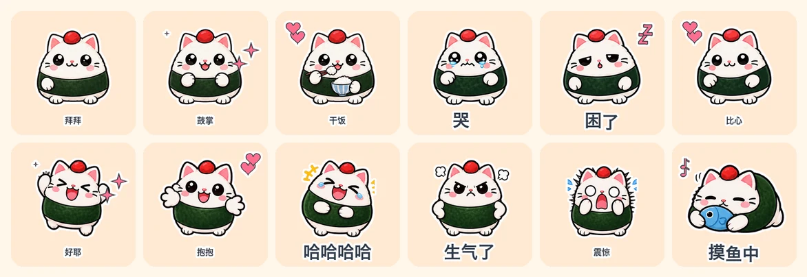

# Animated Sticker Studio

**English** | [中文](README.zh-CN.md)

<p>
  <a href="https://github.com/fantuan-lab/animated-sticker-studio/stargazers"></a>
  <a href="https://github.com/fantuan-lab/animated-sticker-studio/releases"></a>
  
  
  
  <a href="LICENSE"></a>
</p>



Give your AI coding agent one character image (or just a description) and get back a full pack of chat stickers that **actually animate**: it writes the captions and poses, draws every keyframe, adds text and effects, exports to each platform's exact upload spec, compresses every file under the size limit, checks its own work, and zips it up.

Works in Claude Code, Codex, and any agent that can run Python.

## Example: Onigiri Cat · 24 stickers

An original character, made in one run: 1 character sheet + 3 pose sheets = 4 image-generation calls, no manual retouching. Shown below is the WeChat Sticker Platform export (240×240, ≤500 KB each), submitted for WeChat review on 2026-11-05.

**#1–16**: one pose each, plus procedural motion. **#17–24**: real frame-by-frame animation — the paw waves, the tears stream, the yawn opens.

| | | | | | |
|---|---|---|---|---|---|
| <br>001-收到 | <br>002-好耶 | <br>003-抱抱 | <br>004-早安 | <br>005-在吗 | <br>006-哈哈哈哈 |
| <br>007-委屈 | <br>008-生气了 | <br>009-我想想 | <br>010-加油 | <br>011-谢谢老板 | <br>012-溜了 |
| <br>013-震惊 | <br>014-摸鱼中 | <br>015-好的 | <br>016-冲鸭 | <br>017-拜拜 | <br>018-鼓掌 |
| <br>019-打字中 | <br>020-干饭 | <br>021-点赞 | <br>022-哭哭 | <br>023-困了 | <br>024-比心 |

<details>
<summary>The same pack exported to four platforms, all passing their spec checks</summary>

| Platform | Spec | Largest / average file | Limit |
|---|---|---|---|
| Generic GIF | 320×320 GIF | 702 KB / 578 KB | 1 MB (soft) |
| WeChat Sticker Platform | 240×240 GIF + 120 thumbnails + transparent cover and icon | 442 KB / 368 KB | 500 KB |
| Telegram video sticker | 512×512 transparent WebM VP9 | 128 KB / 94 KB | 256 KB |
| LINE animated sticker | 320×270 APNG, 12 frames, 2 loops | 298 KB / 270 KB | 300 KB |

</details>

## What it does

- **Characters really move.** Gesture stickers get 2–4 drawn keyframes (wave, clap, type, eat, cry, yawn…), layered with procedural motion. Most AI sticker tools only slide and squash one still image.
- **22 seamless motion presets**, 5 caption animations (pop, typewriter, wave, shake, static), 17 vector effect icons that stay sharp at any size.
- **Smooth illustration or pixel-art** rendering.
- **Platform presets**: generic GIF, WeChat Sticker Platform, Telegram, LINE, Discord, Slack, WhatsApp — size, format, frame count, duration and byte limits. Files are re-encoded until they fit, and the setting used is recorded.
- **Companion images** each platform asks for: WeChat thumbnails / cover / chat icon, LINE main + tab, Telegram and WhatsApp pack icons.
- **Robust cutting**: removes solid backgrounds and the fake "transparent" checkerboard image models often paint; finds each sprite by its pixels, so uneven grids still cut cleanly; writes a numbered index sheet per atlas.
- **Self-review the agent can actually see**: agents can't watch a GIF, so every sticker is laid out as 4 frames on alternating light/dark rows. Clipping, halos on dark mode, wrong motion and near-duplicate poses (perceptual hash) are flagged; stickers that jump off the canvas are auto-shrunk.
- **Offline preview page** with light / dark / checker / pixel backgrounds and a chat mock-up.
- **CJK fonts found automatically**, with a glyph-coverage check.

## Quick start

**Install**

- Claude Code: put this folder at `~/.claude/skills/animated-sticker-studio/`, or tell Claude: *"Install this skill: https://github.com/fantuan-lab/animated-sticker-studio"*
- Codex: put it at `~/.codex/skills/animated-sticker-studio/` (`agents/openai.yaml` is included).

Requires Python 3 + Pillow (`pip install Pillow`). Telegram export and the MP4 preview also need ffmpeg.

**Make a pack**

Send your agent a character image and say:

> Use animated-sticker-studio to make 16 animated stickers of this character for the WeChat Sticker Platform.

Or: "24 office-worker stickers", "use my own captions", "pixel style", "also export a Telegram version". No image? Describe the character and it will draw a reference sheet for you to approve first.

**Image generation: you only need ONE of these**

| You use | What to set up | Notes |
|---|---|---|
| Codex | Nothing | Codex has a built-in image tool; the skill hands it the prompts |
| Claude Code (recommended: hiapi) | One hiapi key as `HIAPI_API_KEY` | Used for the Onigiri Cat pack, tested. gpt-image-2, 1K transparent, about $0.04 per sheet. Sign up with my invite link: [hiapi.ai/invite/fantuan](https://hiapi.ai/invite/fantuan) |
| Claude Code (fallback: OpenAI) | Only if you already have an OpenAI or compatible-gateway key: `OPENAI_API_KEY` | Code is written but not yet tested; not needed if you use hiapi |

<details>
<summary>Run the scripts yourself</summary>

```sh
# 1. write manifest.json (format: references/manifest.md, captions: references/phrases.md)
# 2. generate pose sheets
python3 scripts/gen_atlas.py manifest.json --provider hiapi
# 3. cut sprites, then check atlases/*.index.png
python3 scripts/cut_atlas.py manifest.json
# 4. render, export, verify, zip
python3 scripts/build_pack.py manifest.json out --platform wechat,telegram --mp4
```

Rebuild the example without spending anything (the cut sprites are in the repo):

```sh
cd examples/onigiri-cat
python3 ../../scripts/build_pack.py manifest.json out --platform generic,wechat
```

</details>

## Repository layout

```
SKILL.md                workflow the agent follows
scripts/gen_atlas.py    prompts + image-generation providers
scripts/cut_atlas.py    background removal, sprite cutting, index sheets
scripts/build_pack.py   render, per-platform export, compression, checks, preview, zip
scripts/sticker_core.py motion, icons, captions, die-cut outline
references/             manifest format, platform specs, caption library (Chinese)
examples/onigiri-cat/   Onigiri Cat: reference, atlases, sprites, finished GIFs
```

## Notes

- Platform specs reflect public requirements as of November 2026; the platform's own console is the final word. Store listings (banners, copyright paperwork, account setup) are still up to you.
- Your reference image is sent to the image provider you choose. Use only characters you own or are licensed to adapt.
- Built after studying [WoYun520/pixel-gif-sticker-pack](https://github.com/WoYun520/pixel-gif-sticker-pack); the Chinese README has a point-by-point comparison.

## License

[MIT](LICENSE)
