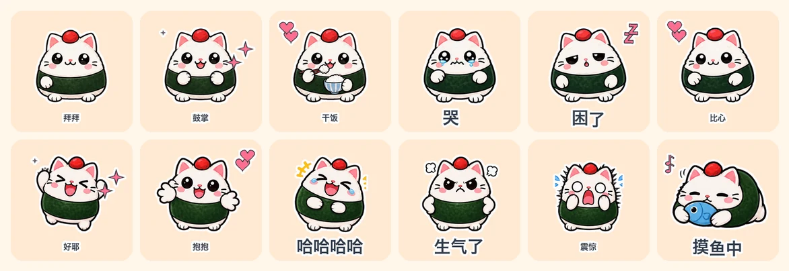

<p align="center">
  
</p>

<p align="center">
  <b>一张角色图 → 一整套会动的聊天表情包。<br>直接导出微信表情开放平台、Telegram、LINE、Discord、Slack、WhatsApp 的上传规格。</b>
</p>

<p align="center">
  <a href="https://github.com/fantuan-lab/animated-sticker-studio/stargazers"></a>
  <a href="https://github.com/fantuan-lab/animated-sticker-studio/releases"></a>
  
  
  
  <a href="LICENSE"></a>
</p>

<p align="center">
  <a href="README.md">English</a> | <a href="README.zh-CN.md"><b>中文</b></a> | <a href="README.ja.md">日本語</a>
</p>

# 动态表情包工坊 · Animated Sticker Studio

给 AI 一张角色图（或者一句描述），它帮你做一整套**真的会动**的聊天表情包：设计台词和动作、画出每一帧、加文字和小特效，按微信 / Telegram / LINE 等平台的上架规格导出，自动压到体积上限以内，自己检查一遍，再打包给你。

Claude Code、Codex 和其他能跑脚本的 AI 编程助手都能用。

## 示例：饭团猫 · 24 张

原创角色。这一套已经用本 skill 导出的微信版本，提交到微信表情开放平台审核（2026-11-05）。

一次生成：1 张设定图 + 3 张动作图集，共调用 4 次出图接口，没有手工修图。下面是微信表情开放平台规格（240×240，每张 ≤500KB）的成品。

**第 1–16 张**：单张姿势，加程序动效。**第 17–24 张**：逐帧动画，手真的在挥，眼泪真的在流，哈欠真的打出来。

| | | | | | |
|---|---|---|---|---|---|
| <br>001-收到 | <br>002-好耶 | <br>003-抱抱 | <br>004-早安 | <br>005-在吗 | <br>006-哈哈哈哈 |
| <br>007-委屈 | <br>008-生气了 | <br>009-我想想 | <br>010-加油 | <br>011-谢谢老板 | <br>012-溜了 |
| <br>013-震惊 | <br>014-摸鱼中 | <br>015-好的 | <br>016-冲鸭 | <br>017-拜拜 | <br>018-鼓掌 |
| <br>019-打字中 | <br>020-干饭 | <br>021-点赞 | <br>022-哭哭 | <br>023-困了 | <br>024-比心 |

<details>
<summary>同一套图导出的四个平台版本，全部通过规格检查</summary>

| 平台 | 规格 | 本套最大 / 平均体积 | 上限 |
|---|---|---|---|
| 通用 GIF | 320×320 GIF | 702KB / 578KB | 1MB（建议值） |
| 微信表情开放平台 | 240×240 GIF + 120 缩略图 + 透明封面和图标（无描边、无文字） | 442KB / 368KB | 500KB |
| Telegram 视频贴纸 | 512×512 WebM VP9 透明 | 128KB / 94KB | 256KB |
| LINE 动态贴图 | 320×270 APNG，12 帧，播 2 遍 | 298KB / 270KB | 300KB |

</details>

## 和 pixel-gif-sticker-pack 比，好在哪

[WoYun520/pixel-gif-sticker-pack](https://github.com/WoYun520/pixel-gif-sticker-pack) 是个不错的项目，示例很多，这个 skill 就是在读完它的代码之后做的。主要多做了这些：

| | pixel-gif-sticker-pack | 动态表情包工坊 |
|---|---|---|
| 角色本身会不会动 | 不会。每张只有一张静态图，靠平移、摇晃、挤压动起来（它的文档原话：*They do not generate new character poses inside a loop*） | 会。可以给一张表情画 2–4 个关键帧（挥手、鼓掌、打字、吃饭、哭、打哈欠……），再叠加程序动效 |
| 程序动效 | 16 种 | 22 种，都是无缝循环；跳跃、惊吓这类动作出框时会自动缩小这一张 |
| 文字动效 | 静态 | 5 种：弹出、逐字打出、波浪、抖动、静态 |
| 小特效 | 16 个像素图标 | 17 个矢量图标，任何尺寸都清晰；像素风下自动变成像素样式 |
| 画风 | 只有像素风 | 平滑插画风 + 像素风 |
| 导出平台 | 320×320 GIF 一种 | 通用 GIF、微信表情开放平台、Telegram、LINE、Discord、Slack、WhatsApp，各自的尺寸、格式、帧数、时长和体积上限 |
| 体积控制 | 不控制（示例每张约 400KB） | 每个平台自动降颜色、质量或帧数，直到低于上限，并记录用了哪档参数 |
| 平台附带图 | 无 | 微信缩略图、封面、图标，LINE main/tab，Telegram 和 WhatsApp 的图标 |
| 出图 | 只能用 Codex 自带的出图工具 | 支持自带工具（打印提示词），也内置 hiapi 和任意 OpenAI 兼容接口 |
| 抠图 | 图集必须已经是透明背景；格子不齐要手填像素坐标 | 自动去掉纯色背景和“假透明”棋盘格；按像素块识别每个角色，格子不齐也能切；每张图集出一张带编号的对照图 |
| 字体 | 必须手动传字体路径 | 自动找系统中文字体，并检查每个字都能显示 |
| 重复检查 | 只查完全相同的图 | 用感知哈希找“几乎一样”的姿势，并分组提示 |
| AI 怎么检查动画 | 导出 MP4（AI 看不了视频） | 生成动作检查图：每张拆 4 帧并排，白底和深色底交替，AI 能直接看出动作、出框和白边 |
| 给人看的预览 | 分类网页 | 离线网页：白底、深色模式、透明格、像素放大四种背景，还有“放进聊天里”的样子 |
| 适用助手 | Codex | Claude Code、Codex，以及其他能跑 Python 的助手 |

## 怎么用

**安装**

Claude Code：把这个文件夹放到 `~/.claude/skills/animated-sticker-studio/`，或者直接对 Claude 说：

> 帮我安装这个表情包 skill：https://github.com/fantuan-lab/animated-sticker-studio

Codex：放到 `~/.codex/skills/animated-sticker-studio/`（`agents/openai.yaml` 已经写好）。

需要 Python 3 和 Pillow（`pip install Pillow`）。导出 Telegram 版本或 MP4 预览还需要 ffmpeg。

**做一套**

把角色图发给 AI，再说一句：

> 用 animated-sticker-studio，拿这张图里的角色做 16 张会动的中文表情包，要上架微信表情开放平台。

也可以说“做 24 张打工人专用的”“用我自己的台词”“像素风”“再出一份 Telegram 版”。没有图也行，描述一下角色，它会先画一张设定图给你确认。

**出图接口：下面三种只要有一种就行，不用全部配置**

| 你在用 | 要准备什么 | 说明 |
|---|---|---|
| Codex | 什么都不用配 | Codex 自带出图工具，skill 会把提示词交给它 |
| Claude Code（推荐用 hiapi） | 一个 hiapi 的 key，设置成环境变量 `HIAPI_API_KEY` | 饭团猫就是用它做的，已实测。gpt-image-2，1K 透明背景，一张图集约 $0.04。没有账号可以用我的邀请链接注册：[hiapi.ai/invite/fantuan](https://hiapi.ai/invite/fantuan) |
| Claude Code（备选：OpenAI） | 已经有 OpenAI 或兼容网关的 key 才用这个：`OPENAI_API_KEY` | 代码已写好，但还没实测过；用 hiapi 的话不需要它 |

<details>
<summary>想自己跑脚本？</summary>

```sh
# 1. 写 manifest.json（格式见 references/manifest.md，台词参考 references/phrases.md）
# 2. 出图集
python3 scripts/gen_atlas.py manifest.json --provider hiapi
# 3. 切图，然后看 atlases/*.index.png，确认编号和台词对得上
python3 scripts/cut_atlas.py manifest.json
# 4. 渲染、导出、检查、打包
python3 scripts/build_pack.py manifest.json out --platform wechat,telegram --mp4
```

不想花钱出图，可以直接重建本仓库的示例（切好的图已经放在仓库里）：

```sh
cd examples/onigiri-cat
python3 ../../scripts/build_pack.py manifest.json out --platform generic,wechat
```

</details>

## 文件结构

```
SKILL.md                给 AI 看的工作流程
scripts/gen_atlas.py    写提示词、调用出图接口
scripts/cut_atlas.py    去背景、切图、生成编号对照图
scripts/build_pack.py   渲染、按平台导出、压缩、检查、预览、打包
scripts/sticker_core.py 动效、图标、文字、描边
references/             清单格式、平台规格、台词库
examples/onigiri-cat/   饭团猫示例：设定图、图集、切好的图、成品 GIF
```

## 注意

- 平台规格按 2026 年 11 月的公开要求整理，提交前以平台后台为准。微信上架还要准备横幅图和版权材料，这部分只能你自己来。
- 参考图会发给你选的出图服务。请只用你自己的角色，或者已经拿到授权的角色。

## 开源许可

[MIT](LICENSE)
